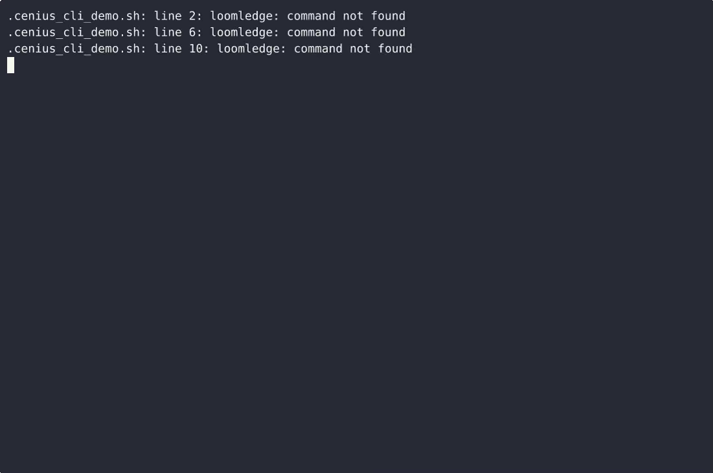
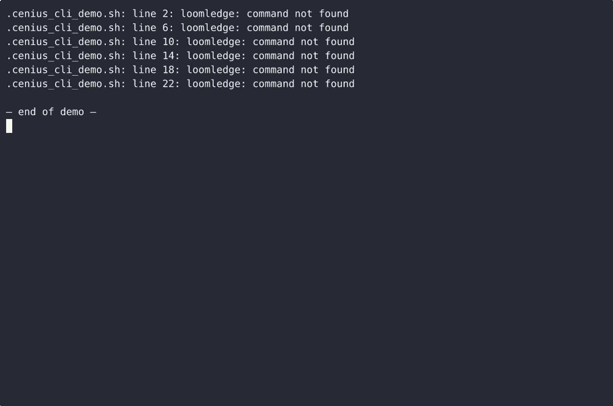

# LoomLedge — complete Full-stack app command-line tool example app

A Full-stack app command-line tool, open-source and ready to self-host: that's **LoomLedge**. LoomLedge is a single-file, standard-library Python command-line tool for hand-weavers that tracks three things about a warp: the acceptable warp-tension tolerance band for each loom (in centinewtons), the heddle coun…. LoomLedge ships complete — source, design assets, seed data — under the Apache-2.0 license; no cloud account needed. [Remix LoomLedge on cenius.ai](https://cenius.ai/marketplace/p/loomledge?ref=gh&utm_campaign=loomledge-webapp) for a custom build.


[](LICENSE)  [](https://cenius.ai)

[](https://cenius.ai/marketplace/p/loomledge?ref=gh&utm_campaign=loomledge-webapp)

> **▶ [Open & edit in cenius.ai](https://cenius.ai/marketplace/p/loomledge?ref=gh&utm_campaign=loomledge-webapp)** — one click to an editable workspace: describe changes in plain English, get an instant preview, one-click deploy and host. Modifications made on the platform come with full rebrand & relicense rights.

_Local clone? See [Quick start](#quick-start) below. cenius.ai is the zero-setup path._

## Demo


▶ **[See it in action](https://cenius.ai/marketplace/p/loomledge?ref=gh&utm_campaign=loomledge-webapp)** — full demo on the project page · [MP4](.github/media/demo.mp4)

## Screenshots

 

## Quick start

```bash
./install.sh   # installs dependencies + seeds demo data
```

See [`INSTALL.md`](INSTALL.md) for full setup and usage instructions.

## Architecture

Full-stack app project, delivered as a complete runnable codebase (23 files). Top-level layout: `tests/`. One command (`./install.sh`) covers dependency setup and demo-data seeding. See [`INSTALL.md`](INSTALL.md) for complete setup instructions.

## Features

- Loom registry with heddle count
- Warp tension tolerance bands
- Tension check and reading log
- Selvedge defect logging
- Local JSON persistence
- Clean aligned output and --json

## Usage guide

### Overview

Warp tension tolerance bands, heddle counts and selvedge defects for hand-weaving studios.

### Quickstart

```bash
loomledge --help
## or, if installed from source without symlink:
python -m loomledge --help
```

### Commands

This CLI exposes **19** subcommands. Each was extracted from the source.

| Command | Source file |
|---------|-------------|
| `loomledge add` | `loomledge.py` |
| `loomledge band` | `loomledge.py` |
| `loomledge check` | `loomledge.py` |
| `loomledge defect` | `loomledge.py` |
| `loomledge history` | `loomledge.py` |
| `loomledge list` | `loomledge.py` |
| `loomledge log` | `loomledge.py` |
| `loomledge login` | `loomledge.py` |
| `loomledge logout` | `loomledge.py` |
| `loomledge loom` | `loomledge.py` |
| `loomledge operator` | `loomledge.py` |
| `loomledge register` | `loomledge.py` |
| `loomledge resolve` | `loomledge.py` |
| `loomledge seed` | `loomledge.py` |
| `loomledge set` | `loomledge.py` |
| `loomledge set-heddles` | `loomledge.py` |
| `loomledge set-shafts` | `loomledge.py` |
| `loomledge show` | `loomledge.py` |
| `loomledge tension` | `loomledge.py` |

#### Per-command help

```bash
loomledge --help                # top-level help
loomledge add --help    # help for `add`
```

### Worked example

1. Verify the CLI is on your PATH: `which loomledge` (or run via `cargo run --`/`python -m`).
2. Show all subcommands: `loomledge --help`.
3. Try the first detected subcommand:

```bash
loomledge add --help
```

### Reference

#### Entry points

_Full guide: [`USAGE.md`](USAGE.md)_

## FAQ

### How do I get LoomLedge running locally?

Everything you need ships in this repo: clone it, run `./install.sh` to install dependencies and seed demo data, then follow [`INSTALL.md`](INSTALL.md) to start it. No external services required.

### Is LoomLedge editable without a developer?

The easiest route: [visit the project on cenius.ai](https://cenius.ai/marketplace/p/loomledge?ref=gh&utm_campaign=loomledge-webapp), tell the platform what to change, and collect the updated build. No source-editing needed.

### Which framework or language does LoomLedge use?

Full-stack app. The full source in this repository is exactly what the app runs. Highlights include local JSON persistence.

### Does the LoomLedge license allow commercial use?

The code is under the Apache-2.0 license, which allows commercial use without restriction. You can build, sell, and deploy it freely. Full text: [LICENSE](LICENSE).

### How do I customise LoomLedge's branding?

Yes. You can edit the source directly under the MIT license, or [remix it on cenius.ai](https://cenius.ai/marketplace/p/loomledge?ref=gh&utm_campaign=loomledge-webapp) — the platform route grants full rebrand and relicense rights over your derivative.

## License & rebranding

Released under the [Apache License 2.0](LICENSE) (© 2026 Cenius AI) — free for personal and commercial use. The Cenius name/logo are trademarks (see NOTICE).

**Need a customized version?** [Remix this app on cenius.ai](https://cenius.ai/marketplace/p/loomledge?ref=gh&utm_campaign=loomledge-webapp) — modifications made on the platform come with **full rebrand & relicense rights** over your derivative.

## Built with cenius.ai

This entire application — code, design, seeded demo data — was generated on **[cenius.ai](https://cenius.ai)** from a plain-English description.

- 🚀 [Build your own app on cenius.ai](https://cenius.ai)
- 🎛️ [Remix LoomLedge on the marketplace](https://cenius.ai/marketplace/p/loomledge?ref=gh&utm_campaign=loomledge-webapp) — open it in a workspace, prompt for changes, and ship your own version.

More open-source apps: [the Cenius-ai catalog](https://github.com/Cenius-ai) · [showcase index](https://github.com/Cenius-ai/showcase)
